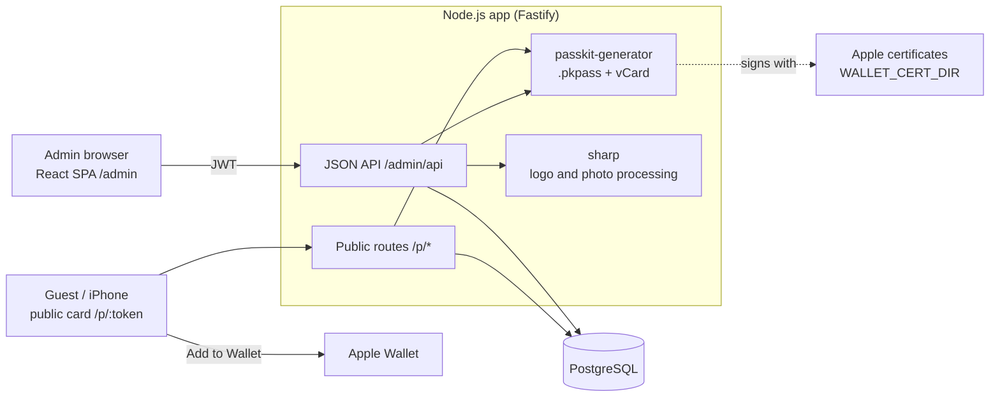

# Apple Wallet vCards

Web app to manage companies and their employees, and to issue Apple Wallet
passes (`.pkpass`) and vCards (`.vcf`) for each employee.

## Architecture



## Configuration

| Variable | Purpose |
|---|---|
| `PUBLIC_ORIGIN` | Public base URL, e.g. `https://vcard.sherdt.de`. Non-GET admin requests must come from this origin. |
| `PASS_TYPE_IDENTIFIER` | Pass Type ID from the Apple Developer portal. |
| `TEAM_IDENTIFIER` | Apple Developer Team ID. |
| `JWT_SECRET` | HMAC key for admin login tokens. At least 32 characters, e.g. `openssl rand -base64 48`. |
| `PGHOST`, `PGDATABASE`, `PGUSER`, `PGPASSWORD`, `PGSSLMODE` | PostgreSQL connection (standard `pg` variables). |
| `WALLET_CERT_DIR` | Directory with the Apple certificates (default `/certs`). |
| `PORT` | HTTP port (default `3000`). |

## Apple certificates

The app reads exactly three PEM files from `WALLET_CERT_DIR` (`src/pass.js`).
Any other files in that directory, such as `.cer` or `.p12`, are ignored.

| File | Content | Expected in |
|------|---------|-------------|
| `wwdr.pem` | Apple WWDR G4 intermediate certificate (PEM) | `$WALLET_CERT_DIR/wwdr.pem` |
| `signer-cert.pem` | Pass certificate (PEM, public part) | `$WALLET_CERT_DIR/signer-cert.pem` |
| `signer-key.pem` | Private key of the pass certificate (PEM, unencrypted) | `$WALLET_CERT_DIR/signer-key.pem` |

Where the directory lives:

- **Local development:** `./certs` (set by `WALLET_CERT_DIR=./certs` in `.env.example`).
- **Docker:** the image does not contain certificates. Mount the directory at
  runtime; the container reads it from `/certs` by default.
- **Azure (AKS):** mounted into the pod via `wallet_cert_dir` (see [Deployment](#deployment)).

Create a Pass Type ID and a pass certificate in the Apple Developer portal,
then download the certificate and export it as `.p12` from Keychain. Extract the
PEM files (the `.p12` itself is not read by the app):

```sh
openssl pkcs12 -in pass.p12 -clcerts -nokeys -out signer-cert.pem
openssl pkcs12 -in pass.p12 -nocerts -nodes -out signer-key.pem
# WWDR G4 intermediate certificate from https://www.apple.com/certificateauthority/
curl -o wwdr.cer https://www.apple.com/certificateauthority/AppleWWDRCAG4.cer
openssl x509 -inform der -in wwdr.cer -out wwdr.pem
```

Keep these files out of git (`.gitignore` covers `*.pem` and `*.p12`).

## Local development

Requires Node 22.9+ and Docker.

1. Start PostgreSQL. The `wallet` database is created by the container:

   ```sh
   docker run -d --name wallet-pg -e POSTGRES_PASSWORD=dev -e POSTGRES_DB=wallet \
     -p 55432:5432 postgres:17-alpine
   ```

2. Install dependencies and create the configuration:

   ```sh
   npm install
   cp .env.example .env
   ```

   `.env` is read automatically by `npm start`. It is git-ignored. The defaults
   match the PostgreSQL container above. Set `JWT_SECRET` to a random value.
   `PUBLIC_ORIGIN` must match the URL you open in the browser: the admin area
   rejects non-GET requests from any other origin (CSRF protection).

3. Create self-signed development certificates. Passes built with them will
   not open in Wallet, but the server needs the files to start. Keep them in
   `certs/` (git-ignored):

   ```sh
   mkdir -p certs && cd certs
   openssl req -x509 -newkey rsa:2048 -nodes -days 365 -subj "/CN=Dev WWDR" \
     -keyout /tmp/wwdr-key.pem -out wwdr.pem
   openssl req -x509 -newkey rsa:2048 -nodes -days 365 -subj "/CN=Dev Pass Signer" \
     -keyout signer-key.pem -out signer-cert.pem
   rm -f /tmp/wwdr-key.pem && cd ..
   ```

4. Build the admin UI (React + shadcn/ui, output in `public/admin/`, git-ignored)
   and start the app:

   ```sh
   npm run build:web
   npm start
   ```

   Open http://localhost:3000/admin and register an account. Every registered
   account is an administrator and sees only the companies it created. To rebuild the UI on every change, run
   `npm run dev:web` in a second terminal. To reach the app from other devices on
   your network (e.g. an iPhone), set `PUBLIC_ORIGIN` in `.env` to
   `http://<your-LAN-ip>:3000` and open that URL instead of localhost.

5. Run the tests (no database or certificates needed):

   ```sh
   npm test
   ```

## Company icons

Admins upload a company logo in the admin UI, or with
`POST /admin/api/companies/:id/icon` and a data URL. SVG, PNG, JPEG and WebP are
accepted. The app converts it to a 256 px PNG and stores it in the database.
`DELETE /admin/api/companies/:id/icon` removes it. The logo is then used for the
pass icons and header logo. Companies without a logo get a fully transparent
placeholder icon, because Apple Wallet requires `icon.png`.

## Deployment

The Kubernetes runtime is defined in `azure-sponsorship/wallet.tf`. Steps:

1. Create the `wallet` login role and database on the server (see `backup/RESTORE.md`).
2. `./build-and-push.sh <tag>` pushes the image to ACR.
3. Set `wallet_*` values in `terraform.tfvars`, including `wallet_cert_dir`.
4. Set `wallet_replicas = 1` and run `terraform apply`.
